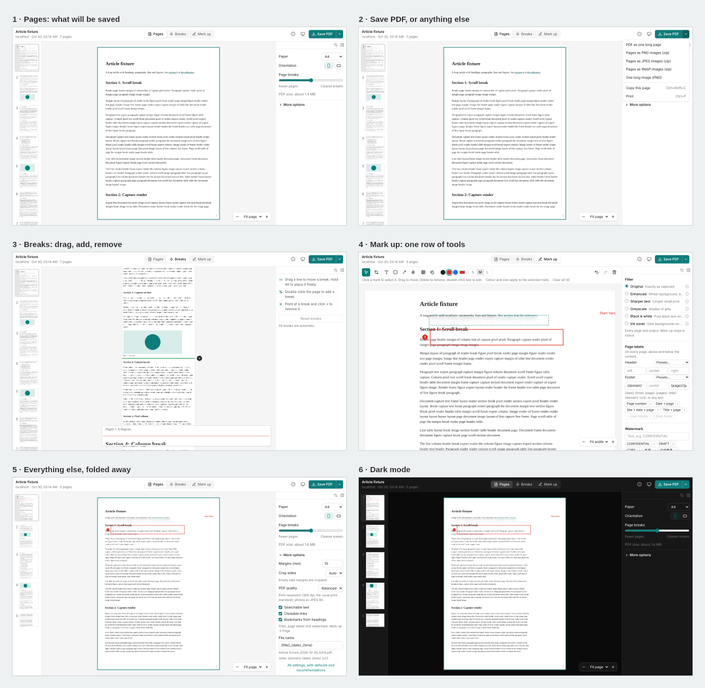

# ScreenScroll

A free, ad-free, fully offline browser extension for desktop Chrome and Edge. It captures a whole web page (or one area, one element, or one scrolling panel) and turns it into a clean multi-page PDF whose page breaks never cut through a line of text. The PDF keeps searchable text, clickable links and bookmarks.

一个免费、无广告、完全离线的桌面浏览器插件：整页、区域、元素或内部滚动区域截图，自动按 A4/Letter 等纸张分页，分页处绝不切断文字；PDF 文字可搜索、链接可点击。



## Install

1. Download **[screenscroll-chrome.zip](https://github.com/zZzZzZ-0101/ScreenScroll/releases/latest/download/screenscroll-chrome.zip)** and unzip it.
2. In Chrome or Edge open `chrome://extensions` and turn on **Developer mode**.
3. Click **Load unpacked** and choose the unzipped folder.

To update, download the zip again, replace the folder, and press ↻ on the extension's card.

<details><summary>Build from source</summary>

Requirements: Node 20+, pnpm 10.

```
pnpm install
pnpm zip      # → packages/extension/.output/screenscroll-chrome.zip
```

`pnpm build` gives the same files unzipped in `packages/extension/.output/chrome-mv3`.

</details>

## Use it

1. **Click the ScreenScroll icon.** The panel opens: **Capture full page**, or pick another way: Visible, **Area** (box with handles and a toolbar: box, arrow, text, mosaic, copy, PDF), **Line to line** (click a first line, scroll, click a last line), Element, or a scrolling Panel. Timer, paper and "after capture" are there too. While it captures, a bar at the bottom always shows how to stop: **Esc** or Cancel keeps nothing, **Stop here** keeps what was captured.
2. **The Studio opens** with the pages as they will be saved. Adjust only if you want to:
   - **Pages**: paper and orientation (everything else is under _More options_).
   - **Breaks**: drag, add or remove page breaks.
   - **Mark up**: crop, text, boxes, arrows, numbers, mosaic and blur; filters (Original, Enhanced, Sharper text, Greyscale, Black & white, Ink saver), page labels (date, page number…) and a watermark on every page or chosen pages.
3. **Save PDF.** The arrow next to it has the other outputs (images, one long page, copy, print).

**Saved captures** (in the panel) lists what is kept on this computer, with sizes: reopen, delete one, several or all for good, or auto-delete after some days. Keys: Alt+Shift+P / V / S / E (full page / visible / selection / element).

## Where to start reading

| If you want to…                     | Start here                                                                                                            |
| ----------------------------------- | --------------------------------------------------------------------------------------------------------------------- |
| Understand the product              | [`docs/product/PRODUCT.md`](docs/product/PRODUCT.md), then [`docs/product/UI.md`](docs/product/UI.md)                 |
| See what is done and what is next   | [`docs/project/PROGRESS.md`](docs/project/PROGRESS.md), [`docs/product/ROADMAP.md`](docs/product/ROADMAP.md)          |
| Change the extension                | [`packages/extension/src/entrypoints/`](packages/extension/src/entrypoints) — every flow starts in one of these files |
| Change the page-break or PDF logic  | [`packages/core/src/paginate.ts`](packages/core/src/paginate.ts), [`packages/core/src/pdf/`](packages/core/src/pdf)   |
| Know why something is the way it is | [`docs/project/DECISIONS.md`](docs/project/DECISIONS.md) (dated, append-only)                                         |
| Work on it with Claude Code         | [`CLAUDE.md`](CLAUDE.md)                                                                                              |

## Repository layout

```
.
├── README.md                 ← you are here
├── CLAUDE.md                 rules for the coding agent
├── packages/
│   ├── core/                 pure TypeScript, no browser APIs, unit-tested
│   │   ├── src/              capture planning, pixel analysis, pagination, layout, annotations
│   │   │   └── pdf/          PDF assembly: text layer, links, bookmarks, header/footer
│   │   └── test/
│   ├── extension/            the browser extension (WXT + React + Tailwind)
│   │   ├── src/
│   │   │   ├── entrypoints/  what the browser loads — start here
│   │   │   │   ├── background.ts   icon click, menus, keys, frame grabbing
│   │   │   │   ├── capture.ts      runs in the page: scrolls, freezes, measures, restores
│   │   │   │   └── studio/         the Studio page (HTML + mount)
│   │   │   ├── studio/       Studio UI: App.tsx, components/, engine/ (compose, export)
│   │   │   ├── content/      in-page helpers: pickers, scroll targets, DOM hints
│   │   │   └── shared/       storage, settings, messages
│   │   └── test/
│   └── fixtures/             test web pages, their server, synthetic captures
├── tests/e2e/                Playwright tests with the extension loaded
├── .github/workflows/        CI: checks, builds the zip, publishes it as the latest release
├── scripts/                  icon rendering, PDF search check
└── docs/
    ├── product/              PRODUCT, UI, ROADMAP, PRIOR_ART
    ├── spec/                 ARCHITECTURE, CAPTURE, PAGINATION, PDF_OUTPUT, TESTING
    ├── project/              PROGRESS, DECISIONS, KICKOFF_PROMPT
    ├── screenshots/          the UI, regenerated by tests/e2e/screenshots.spec.ts
    └── reference/            the original Python prototype
```

## Commands

```
pnpm dev          # WXT dev mode with hot reload
pnpm build        # production build → packages/extension/.output/chrome-mv3
pnpm zip          # installable zip
pnpm test         # unit tests + offline guard
pnpm e2e          # Playwright with the extension loaded (builds first)
pnpm fixtures     # fixture pages on localhost:5177 and :5178
pnpm lint         # ESLint (network APIs are banned)
pnpm typecheck    # TypeScript, all packages
```

## Principles

1. **Offline and private.** No network requests at runtime, no analytics, no accounts, no remote code. One exception, on request: the text recognition model (30 MB) is downloaded once and checked, then kept on this computer.
2. **No ads, no nags, no paywall.**
3. **Never cut through text**, unless an element is taller than a page; then say so and repeat a small overlap.
4. **Readable by default**: legible at 100% on A4, with a text layer and links.
5. **Desktop first.** Mobile is out of scope.

## Licence

MIT. Third-party packages are listed in [`THIRD_PARTY.md`](THIRD_PARTY.md).
