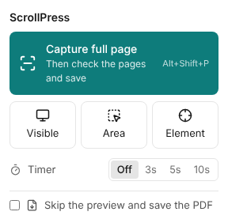

# UI & interaction design

Design stance: **a quiet, fast tool**. No splash screens, no tips carousel, no upsell, no ads. One click captures. Everything advanced is one step away, never in the way.

## Visual language

- Neutral surfaces with one accent colour, e.g. deep teal `#0E7C7B`. Light and dark themes follow the system, with a manual override.
- System font stack (`Segoe UI` on Windows), 13–14 px UI text, 8 px spacing grid, 6 px radius, subtle 1 px borders instead of heavy shadows.
- Icons: Lucide (MIT), bundled.
- Every action shows its keyboard shortcut in a tooltip/menu.
- Motion: 120–160 ms ease-out, and only for state changes (panels, toasts). Respect `prefers-reduced-motion`.
- Accessibility: all controls are keyboard reachable, visible focus rings, contrast ≥ 4.5:1, ARIA labels on icon buttons.

## 1. Popup (toolbar button)

Distilled (2026-10-28, see DECISIONS): the popup answers one question, "what do you want to capture?". Everything that changes how pages look lives in the Studio, where its effect is visible.



```
┌───────────────────────────────────┐
│ ScreenScroll                       │
│ ┌───────────────────────────────┐ │
│ │ ⛶  Capture full page   Alt+Shift+P │  ← the one primary action
│ │    Then check the pages and save│ │    (subtitle changes when "skip" is on)
│ └───────────────────────────────┘ │
│ [ ▭ Visible ][ ⬚ Area ][ ◎ Element ] │  ← three alternatives, tooltips explain
│ ⏱ Timer          [Off 3s 5s 10s]  │
│ ☐ Skip the preview and save the PDF│
└───────────────────────────────────┘
```

- On a page that can't be captured (browser pages, the store, file:// without access) the reason is shown first and the buttons are disabled: no click, then error.
- "Pick scroll area" is in the right-click menu; "Element" already captures a whole panel when the element scrolls.
- Paper and other page settings moved to the Studio. Shortcut defaults are suggestions; users change them at `chrome://extensions/shortcuts`.
- Context menu (right-click page): Capture full page / visible / selection / element / scroll area.

## 2. In-page capture overlay

- A thin progress bar at the top of the viewport, plus a small pill: "Capturing 7/23 · Esc to cancel". It's hidden during frame grabs. Toggle the overlay's visibility right before each `captureVisibleTab`, so the overlay never appears in the output.
- Selection mode: dim the page, draw a crosshair rectangle with size readout, and show handles after release. Auto-scroll when dragging near the top/bottom edge. Press Enter to capture, Esc to cancel.
- Element mode: outline the hovered element with its tag, size and selector. ↑ selects the parent, ↓ the child. Click or Enter captures.

## 3. Studio (main window, extension tab)

Distilled (2026-10-28): three modes named by what you do, one primary button, and a side panel that shows only what matters for the current mode. Advanced settings are one click away under "More options". Overview of every screen: [ui/overview.png](ui/overview.png).

```
┌────────────────────────────────────────────────────────────────────────────┐
│ Page title                     [Pages | Breaks | Mark up]   ⚠ 2 notes [⤓ Save PDF ▾]│
│ example.com · 26 Oct · 7 pages                                             │
├──────┬────────────────────────────────────────────────────┬────────────────┤
│ 1 ▢  │                                                    │ Paper     A4 ▾ │
│ 2 ▢  │      page previews, exactly as saved               │ Orientation ▯ ▭│
│ 3 ▢  │                                                    │ Page breaks    │
│      │                                                    │ Fewer ━●━ Cleaner│
│      │                                                    │ 7 pages · 1.4 MB│
│      │                                                    │ › More options │
└──────┴────────────────────────────────────────────────────┴────────────────┘
```

- **Pages** (default): true page previews. Panel: Paper, Orientation, the "Fewer pages ↔ Cleaner breaks" slider, page count and size. **More options** (closed by default, remembered): margins, crop sides, image quality, searchable text / links / bookmarks, header and footer, file name.
- **Breaks**: the whole capture as one strip with the break lines. Drag to move (snaps; Alt = free), double-click to add, hover × to remove; a magnifier shows the cut. Break colour shows its kind; the tooltip says it in words ("Break between paragraphs"). Panel: three one-line instructions, the slider, **Reset breaks**.
- **Mark up**: the capture at full width with one toolbar row: Select · Arrow, Rectangle, Ellipse, Line · Pen, Highlighter, Text, Step number · Blur, Pixelate · Crop; six colours plus a picker; one size control (S/M/L) for both lines and text; Undo, Redo, Delete. A sentence under the toolbar says what the current tool does. Blur/pixelate also remove the text and links underneath from the PDF. Single-key shortcuts (V C A R O L P H T N B X), Ctrl+Z / Ctrl+Y.
- **Save PDF ▾**: the button saves the PDF (Ctrl+S); the arrow lists every other output: one long page PDF, PNG/JPEG/WebP pages (zip), one long image, Copy this page (Ctrl+Shift+C), Print (Ctrl+P).
- **Notes** chip (warnings) opens the list; "Page N: …" entries jump to the page.
- Left rail: page thumbnails (hidden in Mark up, which needs the width).
- Studio keyboard: ←/→ page, Ctrl+S, Ctrl+Shift+C, Ctrl+P; in Mark up the tool keys, Delete, Esc.
- If the browser refuses the file name (some systems can't store every title), the file is saved under a plain ASCII name and the toast says so.

## 4. History

- A grid of cards: thumbnail, title, domain, date and page count. Search box with **full-text search** over captured page text (stored per session) plus title/URL.
- Multi-select → Merge into one PDF / Export / Delete. A storage meter, with "Keep last N days / max N GB" settings.

## 5. Merge queue

A side sheet in the Studio and History: an ordered list of captures, drag to reorder, per-item page range, then one export.

## 6. Options page

Sections: Capture (delays, lazy-load behaviour, fixed-element rules, capture width, max screens, format), Pages (default paper, margins, crop, break style), PDF (text layer, links, header/footer templates, watermark), Files (filename template, sub-folder, ask where to save), Shortcuts (link to the browser shortcut page), History (retention), Privacy statement ("ScreenScroll never sends data anywhere"), Reset.

## 7. Empty, error & first-run states

- First run: a single small page. "Click the toolbar icon or press Alt+Shift+P on any page." Pin-the-extension hint. No tour.
- Blocked page: a popup message with the reason and the alternative (CAPTURE §13).
- Failure mid-capture: restore the page, keep the frames captured so far, and offer "Open what was captured" or "Retry".
