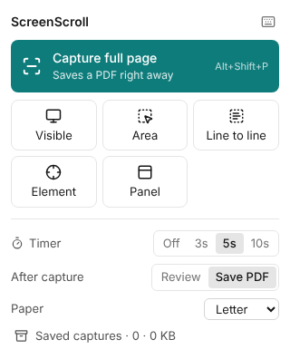
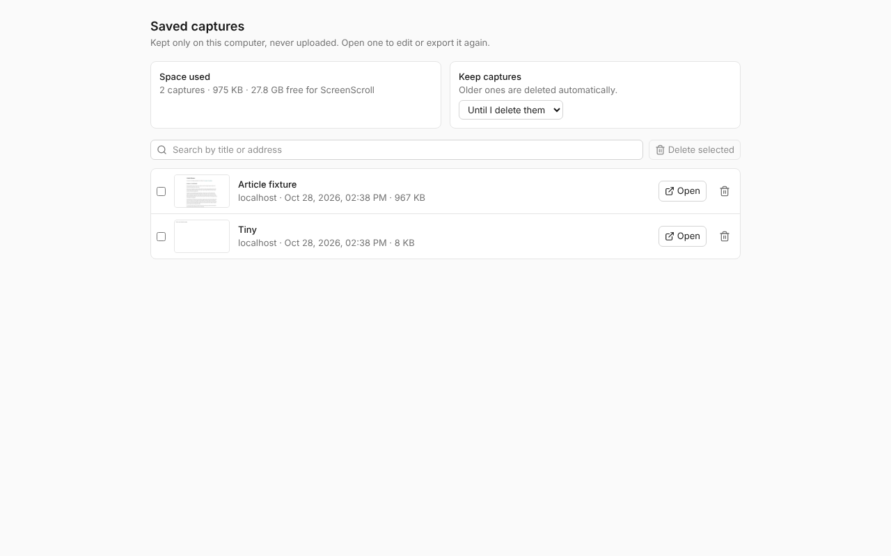

# UI & interaction design

Design stance: **a quiet, fast tool**. No splash screens, no tips carousel, no upsell, no ads. One click captures. Everything advanced is one step away, never in the way.

## Visual language

- Neutral surfaces with one accent colour, e.g. deep teal `#0E7C7B`. Light and dark themes follow the system, with a manual override.
- System font stack (`Segoe UI` on Windows), 13–14 px UI text, 8 px spacing grid, 6 px radius, subtle 1 px borders instead of heavy shadows.
- Icons: Lucide (MIT), bundled.
- Every action shows its keyboard shortcut in a tooltip/menu.
- Motion: 120–160 ms ease-out, and only for state changes (panels, toasts). Respect `prefers-reduced-motion`.
- Accessibility: all controls are keyboard reachable, visible focus rings, contrast ≥ 4.5:1, ARIA labels on icon buttons.

## 1. The panel (toolbar icon)

The icon opens a small panel with everything needed before a capture, nothing else (2026-10-28: an earlier version without a panel was too bare; see DECISIONS).



- **Capture full page** (Alt+Shift+P), the main button.
- Five tiles: **Visible** (Alt+Shift+V), **Area** (Alt+Shift+S), **Line to line**, **Element** (Alt+Shift+E), **Panel** (pick a scrolling panel: mail list, document viewer). Each has a tooltip saying what it does.
- **Timer** Off / 3 / 5 / 10 s · **After capture** Review / Save PDF · **Paper**.
- **Last capture** (reopens it in the Studio) and **Saved captures** with their count and size.
- Keyboard icon: opens the browser's shortcut settings.
- On a page that can't be captured the reason is shown first and the buttons are disabled. Captures started from menus or keys on such a page put a red "!" on the icon with the reason in its tooltip.
- Right-click on the page: full page, visible, selection, line to line, element, scroll area.

## 2. In-page capture overlay

- A pill at the bottom centre: "Capturing · screen 7 · Press Esc to cancel [Stop here] [Cancel]". It stays on screen for the whole capture (frames leave out the rows it covers; it moves to the top for the last frame). Esc / Cancel keep nothing; Stop here keeps what was captured. Scrolling or clicking the page during capture is held off and the pill says so. The toolbar panel shows the same two buttons while a capture runs, and the icon shows REC (WAIT while the tab is in the background).
- Area mode (like a chat app's screenshot tool): dim the page, drag a box; a readout shows `x y · W × H`. Then: drag inside to move, eight handles to resize (left and right edges included), arrow keys nudge 1 px (Shift 10 px), dragging near the top/bottom edge scrolls. A toolbar under the box (above it, or inside, when there's no room): Box (R), Arrow (A), Text (T), Mosaic (M) · Undo (Ctrl+Z) · Extend to the end of the page · Copy (Ctrl+C) · Save PDF (Ctrl+S) · Cancel (Esc) · Capture and review (Enter). Marks drawn here become Studio annotations. Copy and PDF finish in a Studio tab that closes itself, and the page says "Copied as an image · W × H px" or where the PDF was saved.
- **Line to line**: a guide line follows the pointer across whatever scrolls under it. Click the first line, scroll freely (wheel, keys, scrollbar), click the last line; the band between is shaded and its height shown. Enter = to the end, Backspace = choose the start again, Esc = cancel. Clicks never reach the page.
- Element mode: outline the hovered element with its tag, size and selector. ↑ selects the parent, ↓ the child. Click or Enter captures.

## 3. Studio (main window, extension tab)

Distilled (2026-10-28): three modes named by what you do, one primary button, and a side panel that shows only what matters for the current mode. Advanced settings are one click away under "More options". Overview of every screen: [screenshots/overview.png](../screenshots/overview.png).

```
┌────────────────────────────────────────────────────────────────────────────┐
│ Page title                     [Pages | Breaks | Mark up]   ⚠ 2 notes [⤓ Save PDF ▾]│
│ example.com · 26 Oct · 7 pages                                             │
├──────┬────────────────────────────────────────────────────┬────────────────┤
│ 1 ▢  │                                                    │ Paper     A4 ▾ │
│ 2 ▢  │      page previews, exactly as saved               │ Orientation ▯ ▭│
│ 3 ▢  │                                                    │ Page breaks    │
│      │                                                    │ Fewer ━●━ Cleaner│
│      │                                                    │ 7 pages · 1.4 MB│
│      │                                                    │ › More options │
└──────┴────────────────────────────────────────────────────┴────────────────┘
```

- **Document pages**: when the capture is a document viewer (Google Drive, Docs or Office previews, PDF viewers) the Pages panel says "N document pages found" and, by default, makes one PDF page per document page, cropped to the page (no viewer background). Breaks mode then shows the document's breaks without editing; untick "One PDF page per document page" to use smart breaks instead. **By hand**: "Wrong page size? Set pages by hand" (or "A document? Set its pages by hand" when none were found) opens five numbers in CSS px of the capture: First page top, Page height, Gap, Left, Right, prefilled from detection; pages repeat down to the end (a last piece under a fifth of a page is dropped). "Use detected" / "Turn off" goes back. Saved with the capture, undoable.
- **Pages** (default): true page previews. Panel: Paper, Orientation, the "Fewer pages ↔ Cleaner breaks" slider, page count and size. **More options** (closed by default, remembered): margins, crop sides, image quality, searchable text / links / bookmarks, header and footer, file name.
- **Breaks**: the whole capture as one strip with the break lines. Drag to move (snaps; Alt = free), double-click to add, hover × to remove; a magnifier shows the cut. Break colour shows its kind; the tooltip says it in words ("Break between paragraphs"). Panel: three one-line instructions, the slider, **Reset breaks**.
- **Mark up** (scanning-oriented, like a document scanner app): one toolbar row with Select · Crop · Text, Rectangle, Arrow, Step number · Mosaic, Blur; three ink colours (black, red, blue) plus a picker; one size control (S/M/L); Undo, Redo, Delete. The side panel holds **Page**: page labels (header and footer, left/centre/right, with presets such as page number or date + page and tokens) and a **watermark** (text with presets, opacity, size, angle, colour, apply to every page / first page / these pages, remove). Watermark and label presets are the user's own: × removes one, + Save adds the current text or band, Restore defaults brings back removed built-in ones. The watermark shows in the Pages preview and on the Mark up view (at its true size, on the pages it applies to) as it is typed, and is drawn in the PDF. The chosen filter is applied to the Mark up view's page images at once, so it shows before export. Blur/mosaic also remove the text and links underneath from the PDF. Ctrl+Z / Ctrl+Y.
- **Save PDF ▾**: the button saves the PDF (Ctrl+S); the arrow lists every other output: one long page PDF, PNG/JPEG/WebP pages (zip), one long image, Copy this page (Ctrl+Shift+C), Print (Ctrl+P).
- **Notes** chip (warnings) opens the list; "Page N: …" entries jump to the page.
- **Details** (header ⓘ, key I): every number behind the pages and how it was calculated, in the side panel: capture (dpr, frames, size, speed), layout (paper, margins, printable box, content width, scale s, content per page T, body text in pt, dpi on paper), breaks (method, weights, cost formula, forced cuts), output (filter, PDF quality, image scale, format rule, estimated size, labels, watermark), then one row per page. Copy all as text.
- **Pop-ups**: when a pop-up covered the page, the Studio's notes say so with **Hide pop-ups and capture again** (same tab, same mode; the pop-up and its backdrop are hidden for that capture and put back after).
- **Page width** (Settings → Capture): As it is · 1000 · 1200 · 1440 px. A whole-page capture first narrows the window so the page reflows to that width (never wider), then puts the window back.
- **PDF quality** (More options, and Settings): Compact ≤ 150 dpi · Balanced ≤ 300 dpi · Best (every pixel) · Lossless (PNG).
- **Text recognition** (Pages panel card, only when needed): "N pages without text of their own · Pages 3, 5" with Download model (30 MB) once; then "Their text is read when you save". Settings → Text recognition has the mode (Auto / Always / Off) and the model (Download / Remove, size, source).
- Left rail: page thumbnails (hidden in Mark up, which needs the width).
- Studio keyboard: ←/→ page, Ctrl+S, Ctrl+Shift+C, Ctrl+P; in Mark up the tool keys, Delete, Esc.
- If the browser refuses the file name (some systems can't store every title), the file is saved under a plain ASCII name and the toast says so.

## 4. Saved captures (history)



- Everything kept on this computer: thumbnail, title, site, date and size per capture; space used and space free.
- Search titles, addresses and the pages' own text; a match in the text shows the words around it.
- **Open** reopens the Studio. Delete one, several (Select all → Delete selected → Delete N for good) or all, for good: the record and every frame image.
- **Keep captures**: until deleted / 1 / 7 / 30 / 90 days; older captures are deleted when the page opens and after each new capture.
- **Merge into one PDF** (2 or more selected): see §5.

## 5. Merge queue

A sheet on Saved captures (and after a batch): the chosen captures, oldest first, with ↑ / ↓ to reorder, × to leave one out, and a page range each (empty for all, or "1-3, 5"). **Save as one PDF** paginates each capture as the Studio would (its crop, marks, document pages), on the paper and settings of Settings, page numbers running across the document, one bookmark per capture.

## 5a. Capture several pages (batch)

Panel → Capture several pages. Asks once for the browser's all-sites permission (only then). Two ways: **Tabs in this window** (browser pages listed, greyed, with the reason) or **Addresses** (one per line; non-web addresses are named and left out). Each page comes to the front, is captured as a full page and saved without opening a Studio; addresses open in a tab that closes afterwards. A progress list shows each page (captured, skipped with reason, failed with reason); then **Merge into one PDF** or **Open saved captures**.

## 6. Options page

Sections: Capture (delays, lazy-load behaviour, fixed-element rules, capture width, max screens, format), Pages (default paper, margins, crop, break style), PDF (text layer, links, header/footer templates, watermark), Files (filename template, sub-folder, ask where to save), Shortcuts (link to the browser shortcut page), History (retention), Privacy statement ("ScreenScroll never sends data anywhere"), Reset.

## 7. Empty, error & first-run states

- First run: nothing opens. The icon's tooltip says "click to capture the full page, right-click for more". No welcome page, no tour.
- Blocked page: a red "!" on the toolbar icon; its tooltip gives the reason and the alternative (CAPTURE §13).
- Failure mid-capture: restore the page, keep the frames captured so far, and offer "Open what was captured" or "Retry".
